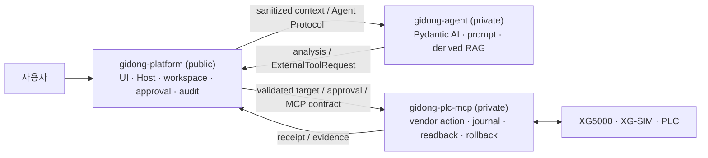

# 기동(GIDONG) PLC 엔지니어링 에이전트 제품 요구사항

| 항목 | 내용 |
| --- | --- |
| 문서 상태 | 제품 기준선 v1 · Living PRD |
| 최종 갱신 | 2026-08-02 |
| 제품 상태 | 개발 중 · production release 아님 |
| 제품 브랜드 | 기동 / GIDONG |
| 제품 형태 | 단일 설치·단일 실행 진입점, 내부적으로 격리된 멀티프로세스 sidecar |
| 소스 구조 | 공개 `gidong-platform`, 비공개 `gidong-agent`, 비공개 `gidong-plc-mcp` |

## 0. 이 문서의 목적과 판정 규칙

이 문서는 기동이 **누구의 어떤 문제를 해결하는 제품인지**, 사용자가 얻게 될
결과가 무엇인지, 제품이 반드시 지켜야 할 안전 원칙과 출시 조건이 무엇인지,
그리고 현재 어디까지 실제로 완료됐는지를 한곳에서 판단하기 위한 최상위
제품 문서다.

잘 만든 PRD는 기능 목록이나 개발 일지가 아니다. 제품 목표, 사용자 흐름,
요구사항, 비범위, 성공 기준과 검증 상태를 연결하여 다음 질문에 같은 답을 주어야
한다.

1. 왜 이 제품을 만드는가?
2. 누구를 위한 제품인가?
3. 사용자는 어떤 결과를 얻는가?
4. 제품은 무엇을 반드시 보장하고 무엇을 절대 해서는 안 되는가?
5. 무엇을 근거로 기능 또는 제품을 완료라고 판정하는가?
6. 현재 검증된 것과 아직 주장할 수 없는 것은 무엇인가?

이 문서와 세부 문서가 충돌하면 제품 범위와 완료 판정에는 이 문서가 우선한다.
세부 사용자 경험은 [GUI 명세](docs/CONTROLSTUDIO_GUI_HANDOFF.md)와
[엔지니어링 작업 흐름](docs/ENGINEERING_COLLABORATION_WORKFLOWS.md), 실행 책임은
[제품 아키텍처](docs/PRODUCT_ARCHITECTURE.md), 배포와 버전 결속은
[제품 배포·버전 정책](docs/refactor/PRODUCT_DISTRIBUTION_AND_VERSIONING.md)을
따른다.

### 상태 용어

| 상태 | 의미 |
| --- | --- |
| 요구됨 | 제품 범위에 포함되지만 구현 또는 검증이 끝나지 않음 |
| 구현됨 | 코드가 존재하고 해당 소프트웨어 테스트가 있음 |
| 자동 검증됨 | mock·fake·fixture·protocol 테스트를 통과함. 실제 장비 성공을 뜻하지 않음 |
| 실제 검증됨 | 지정한 실제 IDE·시뮬레이터·장비 환경에서 직접 실행한 증거가 있음 |
| 부분 완료 | 제한된 입력·버전·경로에서만 구현 또는 검증됨 |
| `NOT_EXECUTED` | 안전 조건이나 실행 환경이 없어 현재 재실행하지 않았음 |
| 미구현·미검증 | 완료로 주장하거나 사용자에게 활성화할 수 없음 |

코드, API, mock 또는 버튼이 존재하는 것만으로 제품 기능을 완료로 판정하지 않는다.
PLC·IDE와 상호작용하는 기능은 지원 환경에서의 실제 증거가 있어야
`실제 검증됨`으로 승격한다.

## 1. 제품 정의

기동은 PLC 프로그램의 신규 구축, 기존 설비 이해, 고장 진단, 변경 계획,
검사·시뮬레이션과 승인된 실행을 하나의 작업공간에서 연결하는
**증거 중심 PLC 엔지니어링 에이전트**다.

기동의 핵심 약속은 다음과 같다.

> 에이전트는 분석하고 제안한다. Platform은 사용자·대상·승인·감사를 결속한다.
> PLC MCP는 실제 대상을 다시 검증하고 변경·readback·rollback을 독립 강제한다.

기동은 단순 챗봇, 범용 코드 생성기, XG5000 화면 자동화 도구가 아니다. 사용자가
어떤 근거로 무엇을 승인하고 실제 대상에 어떤 변화가 생겼는지 끝까지 확인할 수
있는 엔지니어링 제품이어야 한다.

### 제품이 해결하는 문제

PLC 유지보수와 신규 구축 정보는 벤더 IDE, 프로젝트 파일, 현장 문서, 장비 상태,
담당자 경험과 변경 이력에 흩어져 있다. 이 때문에 다음 문제가 반복된다.

- 기존 로직의 의도와 영향 범위를 파악하는 데 오래 걸린다.
- 프로젝트 파일과 실제 대상이 일치하는지 확신하기 어렵다.
- 변경 계획, 승인, 실제 적용, 검증과 원복 기록이 분리된다.
- 숙련자의 현장 지식이 개인에게 남고 재사용 가능한 근거가 되지 못한다.
- AI가 그럴듯한 답을 하더라도 실제 PLC 작업의 권한과 안전을 맡길 수 없다.
- 벤더가 달라질 때마다 사용자 경험과 안전 절차가 다시 만들어진다.

기동은 원본과 대상의 정체성을 먼저 고정하고, 분석 근거와 대안을 보여 주며,
사용자가 승인한 정확한 변경만 실행하고, 실제 readback과 journal로 결과를
확정하는 방식으로 이 문제를 해결한다.

## 2. 목표 사용자와 핵심 작업

| 사용자 | 해결하려는 핵심 작업 |
| --- | --- |
| 제어·자동화 엔지니어 | 요구사항을 PLC 구조와 로직으로 설계하고, 기존 프로그램의 동작과 영향 범위를 빠르게 이해한다. |
| 설비 유지보수 엔지니어 | 알람·정지·품질 문제의 원인을 신호, 인터록, 시퀀스와 연결해 진단하고 안전한 대안을 비교한다. |
| 시스템 통합 담당자 | 신규 프로젝트, 하드웨어·I/O, 운전 모드, 시퀀스, 인터록, 알람과 시험 시나리오를 일관된 산출물로 만든다. |
| 검토·승인 책임자 | 변경 대상, 계획, diff, 위험, 검증과 rollback 가능성을 확인하고 정확한 범위만 승인한다. |
| 제품·릴리스 운영자 | 독립 버전의 Platform·Agent·MCP를 검증된 하나의 제품 조합으로 배포하고 감사 가능한 상태로 유지한다. |

초기 제품의 주 사용 환경은 Windows와 LS ELECTRIC XG5000/XG-SIM이다.
Mitsubishi와 Rockwell 등 다른 벤더는 같은 상위 사용자 경험과 안전 계약을
유지하는 후속 adapter 범위다.

## 3. 제품 목표와 비범위

### 목표

1. 신규 구축과 기존 설비 유지보수를 같은 작업공간과 증거 모델로 지원한다.
2. 로컬 프로젝트 열기, PLC에서 복원하기, 새 프로젝트 시작하기를 동등한 진입
   경로로 제공한다.
3. 프로그램 구조, 신호, 인터록, 시퀀스, 알람과 인과관계를 근거와 함께 설명한다.
4. 진단 결과 하나를 단정하지 않고 가설, 반증 근거, 대안과 예상 영향을 비교한다.
5. 변경을 계획·diff·승인·적용·readback·검사·저장·재열기·시뮬레이션·rollback의
   닫힌 트랜잭션으로 만든다.
6. 사용자의 원본과 작업공간을 보존하면서 모델과 파생 인덱스는 교체 가능하게 한다.
7. 벤더가 달라도 사용자 흐름과 안전 규칙은 유지하고 실제 실행만 adapter로 분리한다.
8. 일반 사용자에게는 저장소나 sidecar가 아니라 하나의 기동 제품만 제공한다.

### 비범위

- XG5000과 같은 벤더 IDE의 범용 래더 편집 화면 전체를 복제하지 않는다.
- AI 판단을 사람의 승인, 설비 안전 절차, 하드웨어 인터록 또는 법정 검사의
  대체물로 취급하지 않는다.
- 근거가 없는 자동 PLC 쓰기, force, mode change, download 또는 run edit을
  활성화하지 않는다.
- mock·합성 테스트를 실제 PLC 검증이라고 부르지 않는다.
- 저장소 분리, 프로세스 기동 또는 패키징 성공을 전체 제품 완성으로 확대하지 않는다.
- 이번 제품에서 지원하지 않는 벤더·CPU·IDE 버전을 추정으로 호환 처리하지 않는다.

## 4. 핵심 사용자 흐름

### 4.1 시작과 작업공간 선택

사용자는 하나의 기동 아이콘으로 제품을 실행한다. Platform은 내부 Agent와 MCP의
버전·hash·계약을 확인하고 필요한 sidecar를 감독한다. 사용자는 다음 중 하나로
작업을 시작한다.

1. 새 PLC 프로젝트 구축
2. 로컬 프로젝트 파일 또는 기존 기동 작업공간 열기
3. 연결된 컨트롤러에서 프로젝트와 파라미터를 안전하게 읽어 작업공간 생성

원본은 불변으로 보존하고 모든 변경은 식별 가능한 working copy에서 수행한다.

### 4.2 신규 구축

사용자는 설비 목적, I/O, 운전 모드, 시퀀스, 인터록, 알람과 복구 조건을 대화와
구조화 화면으로 정리한다. 기동은 빠진 요구사항과 결정이 필요한 항목을 표시하고
다음 산출물을 연결한다.

- 하드웨어·I/O 구성
- 운전 모드와 상태 전이
- 시퀀스와 인터록
- 알람·복구 정책
- 프로그램 구조와 로직
- 검사·시뮬레이션 시나리오

검토가 끝나지 않은 계획을 실제 프로젝트 생성이나 PLC 작업 승인으로 간주하지 않는다.

### 4.3 기존 프로젝트 이해와 유지보수

기동은 원본·working copy·IDE session을 식별한 뒤 프로그램 목록, 사용 신호,
cross-reference, 로직과 시퀀스를 추출한다. 사용자는 자연어 질문에서 시작하되
결과를 프로그램 위치, 원본 문서, 실제 readback과 연결해 확인할 수 있어야 한다.

### 4.4 온라인 읽기와 진단

연결 대상의 strong identity와 프로젝트 일치가 확인된 경우에만 device value,
상태 변화, trace와 알람을 읽는다. 기동은 관측 사실, 추론, 가설과 확인되지 않은
부분을 구분하고, 필요한 추가 관측과 안전한 시험 순서를 제안한다.

### 4.5 승인된 변경

모든 변경은 다음 순서를 닫힌 트랜잭션으로 따른다.

```text
대상 재확인 → 백업 → 변경 계획·diff → 사용자 승인
→ 최소 변경 → native readback → vendor check → 저장
→ 재열기·재추출 → 시뮬레이션/시험 → commit 또는 rollback → 감사 기록
```

대상, 계획, 인자 또는 권한이 승인 뒤 바뀌면 승인은 무효다. 결과가 불명확하면
성공으로 표시하거나 자동 재시도하지 않고 격리·reconciliation한다.

## 5. 제품 요구사항

### 5.1 작업공간과 증거

| ID | 요구사항 | 합격 기준 |
| --- | --- | --- |
| WS-01 | 원본과 working copy를 분리한다. | 원본 hash와 revision이 보존되고 모든 변경은 별도 working copy에서만 발생한다. |
| WS-02 | 프로젝트 출처와 현재 대상을 명시한다. | local, restored-from-controller, new-build 출처와 target identity를 모든 run·evidence에서 추적할 수 있다. |
| WS-03 | 작업을 재개할 수 있다. | 대화, run, 승인, evidence와 미완료 operation을 재시작 뒤 복원한다. |
| WS-04 | 근거를 원문으로 되돌아갈 수 있게 한다. | 분석 결과가 프로그램 위치, 문서 revision, capture 또는 readback reference를 제공한다. |
| WS-05 | 사용자 데이터 수명주기를 Platform이 소유한다. | Agent index를 지워도 원본, workspace, citation, confirmation과 audit가 보존된다. |

### 5.2 분석·설계·진단

| ID | 요구사항 | 합격 기준 |
| --- | --- | --- |
| ENG-01 | 프로그램 구조와 신호 관계를 설명한다. | 프로그램, rung/statement 위치, cross-reference와 근거를 함께 표시한다. |
| ENG-02 | 신규 구축 요구를 구조화한다. | 하드웨어, I/O, mode, sequence, interlock, alarm, recovery와 test 항목의 누락·충돌을 표시한다. |
| ENG-03 | 사실과 추론을 구분한다. | 관측 사실, 파생 해석, 가설, 불확실성과 추가 확인 항목이 분리된다. |
| ENG-04 | 대안을 비교한다. | 각 대안의 영향, 위험, 필요한 변경, 검증 방법과 rollback을 보여 준다. |
| ENG-05 | PLC 작업 지식에 출처를 연결한다. | 검색·기억·모델 답변이 권한이나 target identity를 만들지 않으며 사용한 source를 추적할 수 있다. |

### 5.3 실행·승인·감사

| ID | 요구사항 | 합격 기준 |
| --- | --- | --- |
| EXE-01 | Agent 제안과 실행 권한을 분리한다. | Agent는 `ExternalToolRequest`만 반환하고 raw MCP connection을 소유하지 않는다. |
| EXE-02 | Platform이 실행을 중계한다. | `ExecutionBroker`만 allowlist, schema, capability, target과 approval을 확인하고 MCP를 호출한다. |
| EXE-03 | 승인을 정확한 변경에 결속한다. | 승인에 actor, run, target digest, tool, arguments/plan digest, capability, expiry와 single-use nonce가 포함된다. |
| EXE-04 | MCP가 독립 검증한다. | MCP가 target·precondition·approval을 다시 확인하고 operation journal을 먼저 기록한다. |
| EXE-05 | 실제 결과를 readback으로 확정한다. | apply 응답만으로 성공 처리하지 않고 native readback, check, save/reopen과 evidence를 검증한다. |
| EXE-06 | 실패와 불명확한 결과를 안전하게 처리한다. | 자동 중복 실행 없이 rollback, `ABORTED_NO_MUTATION`, `ROLLED_BACK_SAVED`, `COMMITTED` 또는 `QUARANTINED`로 reconciliation한다. |
| EXE-07 | 감사 연결성을 보장한다. | conversation, run, tool call, operation, approval와 target ID를 Platform audit와 MCP journal 사이에서 추적한다. |

### 5.4 사용자 제품과 배포

| ID | 요구사항 | 합격 기준 |
| --- | --- | --- |
| UX-01 | 하나의 사용자 제품으로 제공한다. | 일반 사용자가 설치 파일, 실행 진입점과 시작 메뉴 항목을 각각 하나만 본다. |
| UX-02 | 내부 구성요소를 자동 관리한다. | Platform이 Agent/MCP를 시작·health check·종료하고 독립 실패를 사용자에게 설명한다. |
| REL-01 | private source를 소비자 설치와 분리한다. | installer가 private Git repository를 clone하거나 source-control credential을 요구하지 않는다. |
| REL-02 | 정확한 조합만 실행한다. | BOM이 Platform, Agent, MCP, contracts의 exact version, contract set, hash와 signature metadata를 고정한다. |
| REL-03 | 전체 조합을 검증·업데이트한다. | 컴포넌트 하나가 바뀌어도 새 product release와 BOM을 만들고 artifact-only black-box E2E를 다시 통과한다. |
| REL-04 | 사용자 데이터를 binary와 분리한다. | 업데이트·rollback·제거가 원본 문서, workspace와 audit를 기본적으로 삭제하지 않는다. |
| REL-05 | 공개 Platform을 독립 개발할 수 있다. | private artifact 없이 Mock Agent와 Mock MCP로 실행·contract test가 가능하다. |

## 6. 제품·저장소·프로세스 경계



| 저장소 | 공개 범위 | 소유하는 권위 | 소유하지 않는 것 |
| --- | --- | --- | --- |
| `gidong-platform` | public | Launcher/UI/Host, 공개 contracts, 사용자 원본·workspace, conversation/run, target binding, approval, `ExecutionBroker`, audit, process supervision, packaging/BOM | private prompt·RAG 정책, vendor native 실행 구현, MCP operation truth |
| `gidong-agent` | private | 공식 Pydantic AI sidecar, 모델 adapter, prompt, 추론·계획, 파생 RAG index/ranking/eval, Agent checkpoint | raw MCP, PID/HWND/endpoint, approval secret, 원본 문서 authority, 실제 변경 성공 판정 |
| `gidong-plc-mcp` | private | vendor adapter, target/precondition 재검증, operation lock/journal, apply/check/readback/rollback/reconciliation | 모델·prompt, Platform UI/API, 사용자 전체 대화와 원본 문서 authority |

공개 계약의 source of truth는 Platform의 `schemas/`다. Agent와 MCP는 공개 계약을
구현하지만 private 구현을 Platform source나 public Git history에 넣지 않는다.

### 데이터 권위

| 데이터 | 권위 소유자 | 원칙 |
| --- | --- | --- |
| 사용자 원본 문서·프로젝트 | Platform | 원본, revision, hash, citation과 삭제·보존 정책을 관리한다. |
| workspace·working copy | Platform | 현재 작업 대상과 사용자 workflow의 기준이다. |
| 파생 chunk·embedding·index·ranking | Agent | sanitize된 snapshot에서 재생성 가능해야 하며 원본을 대체하지 않는다. |
| 모델 대화 checkpoint | Agent | 분석 재개용이며 실제 side effect 성공의 근거가 아니다. |
| run·approval·audit | Platform | 사용자 결정과 tool 중계의 권위다. |
| 실제 변경·readback·rollback journal | PLC MCP | vendor mutation과 crash reconciliation의 최종 권위다. |

## 7. 안전·보안 불변조건

다음 조건은 편의, 모델 성능 또는 출시 일정 때문에 완화할 수 없다.

1. Agent는 raw MCP client, target identity, PID/HWND, controller endpoint 또는
   approval secret을 소유하지 않는다.
2. Platform 승인 없이 mutation을 실행하지 않는다.
3. Platform 승인이 있어도 MCP 재검증을 통과하지 못하면 실행하지 않는다.
4. target, project hash, plan, arguments, capability 또는 nonce가 다르면 fail closed한다.
5. 원본을 직접 변경하지 않고 확인된 working copy와 백업을 사용한다.
6. apply 응답만으로 성공을 선언하지 않고 native readback과 journal을 확인한다.
7. 결과가 불명확한 mutation을 자동 재시도하지 않는다.
8. 모델 출력, 검색 문서와 tool result는 비신뢰 입력이며 권한·승인·대상 정체성을
   만들 수 없다.
9. 공개 저장소의 reachable history에 private Agent/MCP 코드, prompt/eval,
   vendor fixture, 사용자 데이터, 자격 증명이나 실제 endpoint를 넣지 않는다.
10. 실제 PLC에서 검증하지 않은 online capability는 비활성·fail-closed로 유지한다.

## 8. 단일 제품 배포와 버전 정책

일반 사용자는 세 저장소나 세 개의 독립 제품을 설치하지 않는다. 기동은 하나의
installer와 하나의 실행 진입점을 제공하고, Platform이 내부 runtime의 Agent와 MCP
sidecar를 자동으로 관리한다.

소비자 설치 시 private repository에서 코드를 내려받거나 빌드하지 않는다. private
release pipeline이 각 저장소를 독립 build/test하여 만든 immutable artifact를
BOM으로 결속하고, 검증된 조합만 installer에 넣는다.

버전은 다음처럼 분리한다.

- Platform version
- Agent version
- PLC MCP version
- API/Event/Agent/MCP Product/Workspace/Audit contract version
- 위 exact 조합을 나타내는 Product release version

각 저장소는 독립적으로 개발하고 버전을 올릴 수 있지만, 일반 사용자에게 전달되는
조합은 `latest`가 아니라 BOM의 exact version·SHA-256·contract set·signature로
고정한다. 한 컴포넌트만 바뀌어도 새 product release를 만들고 전체 compatibility와
black-box E2E를 다시 검증한다. 업데이트와 rollback도 BOM으로 결속된 전체 조합이
원자적 단위다.

현재 `controlstudio_*`, `controlstudio-*.exe`, `controlstudio-contracts`는 호환성을
위해 남아 있는 기술 식별자다. 제품 브랜드와 저장소 이름은 GIDONG이지만 설치 화면,
실행 파일과 package namespace의 최종 GIDONG 전환은 별도 호환성 마이그레이션과
회귀 검증을 거쳐야 한다.

## 9. 현재 상태 — 2026-08-02

### 9.1 세 저장소 리팩터링

**세 저장소로 나누는 리팩터링 목표는 로컬 기준으로 완료됐다.** 이것은 제품 전체나
실제 PLC online 기능이 완료됐다는 뜻이 아니다.

| 항목 | 상태 | 확인된 내용 |
| --- | --- | --- |
| 버전화된 공개 contracts | 완료·자동 검증 | HTTP/Event/Agent/MCP Product/Workspace/Audit 계약과 Python/TypeScript DTO, contract guard가 Platform에 있음 |
| Platform `ExecutionBroker` | 완료·자동 검증 | tool proposal, allowlist/schema, target binding, approval, MCP relay와 audit 경계를 Platform이 소유함 |
| Agent의 raw MCP 직접 접근 제거 | 완료·자동 검증 | Agent는 `ExternalToolRequest`만 제안하고 raw MCP/PID/HWND/approval secret을 갖지 않음 |
| 공식 Pydantic AI Agent sidecar | 완료·자동 검증 | private Agent가 별도 supervised NDJSON 프로세스로 동작하고 공개 Agent Protocol을 구현함 |
| MCP 독립 안전 강제 | 완료·자동 검증 | Product Contract, precondition, journal, readback, rollback, quarantine 경계가 private MCP에 있음 |
| 원본·파생 데이터 분리 | 완료·자동 검증 | 원본/workspace authority는 Platform, 파생 RAG·추론·prompt는 Agent가 소유함 |
| 세 sibling local Git | 완료 | `gidong-platform`, `gidong-agent`, `gidong-plc-mcp`가 독립 Git으로 존재하고 원본 monorepo/history는 보존됨 |
| 저장소 독립 build/test | 완료·자동 검증 | 분리 당시 Platform, Agent, MCP의 독립 test·lint·build가 통과함 |
| 공개 Platform mock 실행 | 완료·자동 검증 | private artifact 없이 public Mock Agent/MCP로 Platform 실행과 contract self-test가 통과함 |
| 세 packaged artifact black-box E2E | 완료·자동 검증 | editable sibling source가 아닌 세 executable과 contracts wheel만으로 handshake·relay·lifecycle 검증이 통과함 |
| BOM과 단일 실행 조립 | 개발 범위 완료 | exact version/hash/contracts를 고정한 portable product와 단일 launcher self-test가 통과함 |
| 공개 history 분리 | 완료 | Platform은 private monorepo history를 가져오지 않은 clean public history로 만들었고 분리 시 전체 reachable scan이 통과함 |
| remote/push | 의도적으로 미실행 | 세 저장소 모두 remote가 없으며 사용자 지시 전에는 생성·push하지 않음 |

분리 검증 당시 독립 테스트에는 Platform Host·Launcher·Web·contracts·mocks·conformance·
packaging, Agent package/ruff/build, MCP unit·safety·ruff/build가 포함됐다. packaged
product는 공식 Agent ready, knowledge sync/search, MCP manifest/schema digest,
39개 MCP tool catalog, Platform health/static UI와 hash/contract 불일치 fail-closed를
확인했다. 이는 소프트웨어 경계와 패키징 증거이지 실제 PLC online 증거는 아니다.

### 9.2 제품 기능

| 제품 범위 | 현재 상태 | 완료로 주장할 수 있는 범위 |
| --- | --- | --- |
| 단일 Launcher→Host→Web/PWA 사용자 흐름 | 부분 완료·자동 검증 | 로컬 실행, planning conversation, workspace 상태와 sidecar lifecycle의 vertical slice |
| 로컬 프로젝트·불변 원본·working copy | 부분 완료·실제/자동 검증 | 지정된 XG5000 working copy 열기, 저장된 workspace 재개와 원본 hash 보존 |
| 프로그램 목록·LD 추출·제한 분석 | 부분 완료·과거 실제 증거 | 지정 실제 XG5000 프로젝트 복사본에서 LD 4개와 visual row 344 read/analysis |
| 제한된 오프라인 LD 변경·원복 | 부분 완료·과거 실제 증거 | 지정 복사본의 한 operand 변경, diff, check, rollback 후 payload와 file hash 원복 |
| XG-SIM 시험 경로 | 부분 완료·과거 실제 증거 | 시험 프로젝트의 IL 삽입/readback, check, save/reopen, RUN/STOP과 제한된 신호 추종 |
| 계획·지식·RAG | 부분 완료·자동 검증 | planning workflow, 문서 수집, FTS/파생 index, citation/memory/control pattern의 vertical slice |
| 일반 신규 XG5000 프로젝트·하드웨어·LD 생성 | 미완료 | 제한된 자동 경로가 전체 신규 구축 요구를 충족하지 않음 |
| 일반 기존 프로젝트 분석·진단 | 미완료 | 임의 프로젝트와 실제 설비에서 완전한 구조·인과·영향 분석을 검증하지 않음 |
| 실제 PLC strong identity·복원·parameter readback | 미검증 | IDE attach는 PLC 연결 증거가 아니며 현재 완료로 주장하지 않음 |
| 실제 PLC online observe | 미검증 | device value, trace, alarm의 실제 장비 E2E 없음 |
| 실제 PLC write·run edit·force·mode·download | 미구현 또는 미검증 | 활성화하거나 완료로 주장하지 않으며 fail-closed 유지 |
| Mitsubishi·Rockwell adapter | 미구현 | 멀티벤더 아키텍처 경계만 존재함 |

현재 XG5000 재실행 진단은 안전 조건을 충족하지 않아 `NOT_EXECUTED`다. 과거의
제한된 read/offline-change/rollback 증거는 보존하지만, 이를 현재 세 packaged
component 전체나 실제 online PLC의 재검증으로 해석하지 않는다.

### 9.3 출시 준비

| 항목 | 상태 |
| --- | --- |
| offline portable/개발 installer 조립 | 구현·자동 검증됨 |
| 일반 사용자에게 하나의 설치·실행 단위 제공 | 개발 artifact 기준 자동 검증됨 |
| production Authenticode code signing | 미완료 |
| 접근 통제된 immutable artifact registry | 미완료 |
| 서명된 update manifest와 안전한 전체 조합 rollback | 미완료 |
| 사용자 데이터 migration·backup·복구 시험 | 미완료 |
| 지원 Windows 설치·업데이트·제거 행렬 | 미검증 |
| production release | 준비되지 않음 |

따라서 현재 정확한 판정은 다음과 같다.

- **3-repository 리팩터링:** 완료
- **개발용 세 artifact 조립·black-box 경계:** 완료
- **기동 제품 전체 PRD:** 미완료
- **production 배포:** 미완료
- **실제 PLC online 기능:** 미검증·fail-closed

## 10. 남은 제품 로드맵과 승격 게이트

로드맵의 순서는 기능을 켜는 순서이며 날짜 약속이 아니다. 앞 단계의 증거가 없는
고위험 기능을 뒤 단계에서 먼저 활성화하지 않는다.

### G0 — 공개·배포 기반 확정

- 실제 법적 저작권자 명칭 확정 및 Platform `LICENSE`/`NOTICE` 최종 확인
- GitHub 조직 `gidong-controls`와 세 repository visibility 확정 후 별도 지시에 따라 remote/push
- GIDONG 제품 표시명과 기존 `controlstudio_*` 기술 식별자의 호환성 마이그레이션 결정
- production code signing, immutable artifact registry, signed manifest, updater와 전체 BOM rollback
- clean Windows 설치·업데이트·제거 및 사용자 데이터 보존 행렬 통과

### G1 — LS read-only 엔지니어링 release

- 지원 XG5000·XG-SIM·Windows·CPU 조합을 명시
- 안전한 실제 XG5000 working copy에서 packaged product read 경로 재검증
- 컨트롤러 strong identity, 프로젝트·파라미터 readback과 restore/compare 구현·실기 검증
- 프로그램 구조·cross-reference·logic graph·근거 탐색의 대표 프로젝트 acceptance 통과

### G2 — LS 신규 구축과 일반 오프라인 편집

- 하드웨어·I/O·mode·sequence·interlock·alarm 산출물의 닫힌 workflow
- 일반 LD 생성·편집, vendor check, save/reopen, diff와 rollback
- representative project와 XG-SIM 시나리오에서 요구사항→프로젝트→시험 E2E 통과

### G3 — 실제 online observe

- 실제 장비 identity와 권한을 결속한 device value, trace, alarm read
- disconnect·stale target·project mismatch·통신 오류 fail-closed 검증
- 관측 evidence와 진단 가설을 UI·audit에서 구분

### G4 — 승인된 실제 변경

- 실제 PLC write, download, mode change, run edit와 force를 capability별로 별도 승인
- 현장 안전 절차, 백업·readback·reopen·rollback·crash recovery 실기 gate 통과
- 지원 vendor/CPU/firmware 조합별 enablement; 미검증 조합은 계속 비활성

### G5 — 추가 벤더

- Mitsubishi·Rockwell adapter를 같은 Product Contract와 안전 불변조건 아래 구현
- 벤더별 실제 읽기·오프라인 변경·시뮬레이션·online capability를 독립 증거로 승격

## 11. 성공 지표

### 절대 통과 지표

- 승인되지 않았거나 stale/mismatched target인 mutation의 실행: **0건**
- 결과 불명확 상태를 성공으로 표시하거나 자동 재실행한 mutation: **0건**
- 승인된 mutation의 Platform audit와 MCP journal 연결 누락: **0건**
- public reachable history의 private 코드·secret·사용자 데이터: **0건**
- BOM과 다른 component·contract·hash를 실행한 release: **0건**
- 지원한다고 표시한 PLC capability 중 지정 실기 gate를 통과하지 않은 항목: **0건**

### 제품 효과 지표

pilot 전에 대표 LS 프로젝트와 실제 사용자 작업 집합을 고정하고 다음을 측정한다.

- 기존 프로젝트의 프로그램·신호·원인 위치를 근거와 함께 찾는 성공률과 소요 시간
- 신규 구축 요구사항의 누락·충돌 탐지율과 검토 완료까지의 시간
- 진단 답변의 원문·program location·readback citation 연결률
- 제안된 변경의 diff 정확도, vendor check·save/reopen·simulation 통과율
- rollback 성공률과 불명확 operation의 안전한 quarantine 비율
- 사용자가 AI 답변을 수정·거절한 이유와 반복 오류율

목표 수치는 임의로 정하지 않고 대표 corpus와 pilot baseline을 만든 뒤 release별로
고정한다. 단, 위 절대 통과 지표는 pilot 결과와 무관하게 완화하지 않는다.

## 12. 릴리스 완료 기준

어떤 capability든 다음 증거가 모두 있어야 지원 완료로 표시할 수 있다.

1. 지원 vendor·제품·버전·환경과 비지원 범위가 명시돼 있다.
2. 공개 계약과 구현이 일치하고 독립 unit·integration·conformance test가 통과한다.
3. 세 packaged artifact의 exact BOM 조합으로 black-box E2E가 통과한다.
4. IDE·simulator·PLC 기능이면 지정 실제 환경의 replay 가능한 evidence가 있다.
5. target mismatch, stale state, crash, timeout, tamper와 denial 경로가 fail-closed다.
6. mutation이면 승인, journal, readback, save/reopen, rollback과 reconciliation이
   끝까지 증명된다.
7. 사용자에게 구현·자동 검증·실제 검증·미검증 상태가 정확히 표시된다.
8. documentation, audit, migration과 support matrix가 해당 release와 함께 고정된다.

전체 제품 완료는 신규 구축, 기존 프로젝트 이해, online observe, 승인된 변경과
단일 production 배포가 지원 범위에서 위 조건을 모두 통과했을 때만 선언한다.
현재는 이 조건을 충족하지 않았다.

## 13. 확정 결정과 남은 결정

### 확정됨

- 제품 브랜드: 기동 / GIDONG
- GitHub 조직 후보와 repository namespace: `gidong-controls`
- repository: `gidong-platform` public, `gidong-agent` private,
  `gidong-plc-mcp` private
- 일반 사용자 제품: 단일 설치·단일 진입점, 내부 sidecar architecture
- public license: Apache License 2.0
- Agent/MCP license: private proprietary, All Rights Reserved
- installer는 private repository를 clone하지 않고 미리 빌드된 artifact만 조립
- component 독립 버전 + exact product BOM 정책

### 공개·production 전에 확정해야 함

- `GIDONG Controls`가 아닌 경우 실제 개인 또는 법인 저작권자 명칭
- GIDONG 상표·도메인·publisher 표시명
- 소비자 실행 파일과 package/artifact namespace의 최종 명칭 및 migration 방식
- 최초 지원 XG5000·XG-SIM·Windows·PLC CPU/firmware matrix
- 모델 provider, credential, telemetry와 사용자 데이터 보존 정책
- standalone PLC MCP의 별도 배포·라이선스·지원 정책
- production signing certificate, artifact registry와 release channel 운영 주체

## 14. 근거 문서

- [사용자 GUI와 실행 경험](docs/CONTROLSTUDIO_GUI_HANDOFF.md)
- [사람·에이전트 엔지니어링 작업 흐름](docs/ENGINEERING_COLLABORATION_WORKFLOWS.md)
- [제품 아키텍처](docs/PRODUCT_ARCHITECTURE.md)
- [책임과 데이터 소유권](docs/refactor/RESPONSIBILITY_AND_DATA_OWNERSHIP.md)
- [단일 제품 배포와 독립 버전 정책](docs/refactor/PRODUCT_DISTRIBUTION_AND_VERSIONING.md)
- [로컬 3-repository 작업 흐름](docs/refactor/LOCAL_THREE_REPO_WORKFLOW.md)
- [패키징과 BOM 경계](docs/refactor/PACKAGING.md)
- [리팩터링 검증 기준](docs/refactor/REFACTOR_VALIDATION_EVIDENCE.md)
- [XG5000 회귀 증거와 미검증 범위](docs/refactor/XG5000_REGRESSION_EVIDENCE.md)
- [GIDONG 저장소 이름과 라이선스 경계](docs/REPOSITORY_NAMING.md)
