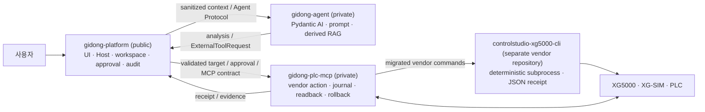

# 기동(GIDONG) PLC 엔지니어링 에이전트 제품 요구사항

여러 저장소의 공통 책임·계약·통합 규칙은 [루트 ARCHITECTURE](../ARCHITECTURE.md), 현재 작업은 [HANDOFF](../HANDOFF.md)에서 관리한다.

| 항목 | 내용 |
| --- | --- |
| 문서 상태 | 대형 XG5000 LD 제어 구조 타당성 인수 완료 · 선정 구조에 따른 제품 개발 기준선 |
| 최종 갱신 | 2026-10-16 |
| 제품 상태 | 개발 중 · production release 아님 |
| 제품 브랜드 | 기동 / GIDONG |
| 제품 형태 | 단일 설치·단일 실행 진입점, 내부적으로 격리된 멀티프로세스 sidecar |
| 소스 구조 | 공개 `gidong-platform`, 비공개 `gidong-agent`·`gidong-plc-mcp`, 별도 vendor repository `controlstudio-xg5000-cli` |

사용자는 채팅으로 PLC 개발·분석·수정을 맡긴다. 모델이 필요한 자료와 현재 LD를 읽고,
설계·도구 선택·실패 수정·저장·마무리를 판단한다. 제품은 선택·실행·결과를 같은 대화에
표시하고, 중단 후에도 요청과 실제 작업 이력을 이어간다.

XG5000의 네이티브 LD 데이터와 구조 지도에 근거한 부분 편집 방식을 제품 개발 기준으로 인수했다.
[인수 근거](../artifacts/ld-feasibility/native-structure-current.json)는 보존하며,
구현 순서는 [구현 계획](docs/AGENT_PRODUCT_PLAN.md), 현재 진행은 [HANDOFF](../HANDOFF.md)를 따른다.

## 요구사항의 출처와 이번 작업 범위

- 대화에서 명시한 요구: 모델 주도 조사·설계·실행·수정, LD만 사용, 구조적 부분 편집,
  실제 웹·XG5000·XG-SIM 동작, 수정본 저장·readback·재시험, 후속 변경·중단·재개,
  대동인덱스와 두 펌프 교번 운전, 작은 문맥의 모델에서도 작업 지속.
- 기존 PRD에 있던 제품 범위: 신규/기존 프로젝트·컨트롤러 복원, 원본 보호, 근거 기반
  설명·진단, 단일 설치·실행, 배포·사용자 데이터 보존, 후속 물리 PLC·다른 벤더 지원.
  이번 최소 실행의 성공만으로 이 범위 전체를 완료로 바꾸지 않는다.
- 기존 에이전트가 정한 수단: Pydantic AI, 현재 Host/MCP/CLI 분할, 고정 compiler/mission,
  digest·nonce·Keep 절차, 200k 입력 하한은 사용자 요구와 구분한다. 현재 저장소/계약은
  보존할 데이터와 실제 재사용 가능성을 판단할 대상이지 반드시 유지할 설계가 아니다.
- 타당성 단계에서 실제 대형 LD의 앞·중간·끝 탐색, 여러 프로그램의 부분 변경·보존,
  저장본 재열기와 선정 방식의 비용 비교를 수행했다. 다음 개발은 이 결과를 사용한 제품
  구현이며, 기존 성공 근거를 반복하는 대신 신규 대상 준비·자료 조사·웹·SIM 연결을 완성한다.

## 0. 이 문서의 목적과 판정 규칙

이 문서는 제품 목표·사용자 흐름·요구사항·범위·완료 판정 기준을 정의한다.
현재 적용·실행·검증 상태는 [HANDOFF](../HANDOFF.md)에서 관리한다.
제품 범위와 완료 기준은 이 문서를 따르며, 최신 사용자 지시가 우선한다.
세부 사용자 경험은 [GUI 명세](docs/CONTROLSTUDIO_GUI_HANDOFF.md)와
[엔지니어링 작업 흐름](docs/ENGINEERING_COLLABORATION_WORKFLOWS.md), 실행 책임은
[제품 아키텍처](docs/PRODUCT_ARCHITECTURE.md), 배포와 버전 결속은
[제품 배포·버전 정책](docs/refactor/PRODUCT_DISTRIBUTION_AND_VERSIONING.md)을
따른다.

## 1. 제품 정의

기동은 PLC 프로그램의 신규 구축, 기존 설비 이해, 고장 진단, 변경·검사·시뮬레이션을
하나의 작업공간에서 수행하는 **PLC 개발·협업 에이전트**다.

기동의 핵심 약속은 다음과 같다.

> 사용자가 채팅으로 PLC 개발·분석·수정을 맡기면, 에이전트가 도구를 선택하고 실제
> 결과를 보고 작업을 이어간다. 사용자는 현재 행동과 결과를 바로 보고 개입할 수 있다.

기본 화면은 간단한 채팅이다. 개발 에이전트의 실행 루프가 주 기능이고, 변경 내역과
상세 도구 결과는 대화에서 필요한 만큼 펼쳐 본다. 대상 확인과 작업 사본 보호는
실행 도구가 담당하며 PID/HWND·해시·저널을 사용자의 기본 업무로 만들지 않는다.

### 제품이 해결하는 문제

PLC 유지보수와 신규 구축 정보는 벤더 IDE, 프로젝트 파일, 현장 문서, 장비 상태,
담당자 경험과 변경 이력에 흩어져 있다. 이 때문에 다음 문제가 반복된다.

- 기존 로직의 의도와 영향 범위를 파악하는 데 오래 걸린다.
- 프로젝트 파일과 실제 대상이 일치하는지 확신하기 어렵다.
- 변경 계획, 승인, 실제 적용, 검증과 원복 기록이 분리된다.
- 숙련자의 현장 지식이 개인에게 남고 재사용 가능한 근거가 되지 못한다.
- AI가 그럴듯한 답을 하더라도 실제 PLC 작업의 권한과 안전을 맡길 수 없다.
- 벤더가 달라질 때마다 사용자 경험과 안전 절차가 다시 만들어진다.

기동은 사용 가능한 원본과 근거에서 분석·설계·로컬 작업을 시작하고, 사용자가 방향과
결과를 함께 검토할 수 있게 한다. 선택한 프로젝트나 실제 대상에 적용할 때에는
정확한 대상과 결과를 readback·journal로 확인한다.

## 2. 목표 사용자와 핵심 작업

| 사용자 | 해결하려는 핵심 작업 |
| --- | --- |
| 제어·자동화 엔지니어 | 요구사항을 PLC 구조와 로직으로 설계하고, 기존 프로그램의 동작과 영향 범위를 빠르게 이해한다. |
| 설비 유지보수 엔지니어 | 알람·정지·품질 문제의 원인을 신호, 인터록, 시퀀스와 연결해 진단하고 안전한 대안을 비교한다. |
| 시스템 통합 담당자 | 신규 프로젝트, 하드웨어·I/O, 운전 모드, 시퀀스, 인터록, 알람과 시험 시나리오를 일관된 산출물로 만든다. |
| 검토·승인 책임자 | 변경 대상, 계획, diff, 위험, 검증과 rollback 가능성을 확인하고 정확한 범위만 승인한다. |
| 제품·릴리스 운영자 | 독립 버전의 Platform·Agent·MCP를 검증된 하나의 제품 조합으로 배포하고 감사 가능한 상태로 유지한다. |

초기 제품의 주 사용 환경은 Windows와 LS ELECTRIC XG5000/XG-SIM이다.
Mitsubishi와 Rockwell 등 다른 벤더는 같은 상위 사용자 경험과 안전 계약을
유지하는 후속 adapter 범위다.

## 3. 제품 목표와 비범위

### 목표

1. 신규 구축과 기존 설비 유지보수를 같은 작업공간과 증거 모델로 지원한다.
2. 로컬 프로젝트 열기, PLC에서 복원하기, 새 프로젝트 시작하기를 동등한 진입
   경로로 제공한다.
3. 프로그램 구조, 신호, 인터록, 시퀀스, 알람과 인과관계를 근거와 함께 설명한다.
4. 진단 결과 하나를 단정하지 않고 가설, 반증 근거, 대안과 예상 영향을 비교한다.
5. 요청한 변경·저장 결과를 실제 도구 반환으로 확인하고, 재열기·시뮬레이션·원복은
   요청이나 실패 원인에 필요할 때 선택한다. 모든 저장에 고정 절차를 강제하지 않는다.
6. 사용자의 원본과 작업공간을 보존하면서 모델과 파생 인덱스는 교체 가능하게 한다.
7. 벤더가 달라도 사용자 흐름과 안전 규칙은 유지하고 실제 실행만 adapter로 분리한다.
8. 일반 사용자에게는 저장소나 sidecar가 아니라 하나의 기동 제품만 제공한다.

### 비범위

- XG5000과 같은 벤더 IDE의 범용 래더 편집 화면 전체를 복제하지 않는다.
- AI 판단을 사람의 승인, 설비 안전 절차, 하드웨어 인터록 또는 법정 검사의
  대체물로 취급하지 않는다.
- 근거가 없는 자동 PLC 쓰기, force, mode change, download 또는 run edit을
  활성화하지 않는다.
- 로컬 합성 결과나 정적 검사를 실제 PLC 검증이라고 부르지 않는다.
- 저장소 분리, 프로세스 기동 또는 패키징 성공을 전체 제품 완성으로 확대하지 않는다.
- 이번 제품에서 지원하지 않는 벤더·CPU·IDE 버전을 추정으로 호환 처리하지 않는다.

## 4. 핵심 사용자 흐름

### 4.1 시작과 작업공간 선택

사용자는 하나의 기동 아이콘으로 제품을 실행한다. Platform은 내부 Agent와 MCP의
버전·hash·계약을 확인하고 필요한 sidecar를 감독한다. 사용자는 다음 중 하나로
작업을 시작한다.

1. 새 PLC 프로젝트 구축
2. 로컬 프로젝트 파일 또는 기존 기동 작업공간 열기
3. 연결된 컨트롤러에서 프로젝트와 파라미터를 안전하게 읽어 작업공간 생성

원본은 불변으로 보존하고 모든 변경은 식별 가능한 working copy에서 수행한다.

### 4.2 신규 구축

사용자는 설비 목적, I/O, 운전 모드, 시퀀스, 인터록, 알람과 복구 조건을 대화와
구조화 화면으로 정리한다. 기동은 빠진 요구사항과 결정이 필요한 항목을 표시하고
다음 산출물을 연결한다.

- 하드웨어·I/O 구성
- 운전 모드와 상태 전이
- 시퀀스와 인터록
- 알람·복구 정책
- 프로그램 구조와 로직
- 검사·시뮬레이션 시나리오

네이티브 설계의 I/O, mode, control network, timer, sequence, alarm, recovery,
safety 항목은 알려진 사실, 가정과 미결 사항을 구분한다. 미결 사항은 명시한 채로
분석·설계·로컬 산출물 작업을 계속할 수 있다. 다만 물리·위험 출력을 만들거나
적용할 때에는 관련 interlock 또는 외부 안전 경계를 결정해야 한다.

### 4.3 기존 프로젝트 이해와 유지보수

기동은 사용 가능한 프로젝트·문서에서 프로그램 목록, 사용 신호, cross-reference,
로직과 시퀀스를 추출한다. IDE session·working copy가 있으면 결과를 연결하며,
없어도 분석은 출처와 한계를 표시하고 진행한다.

### 4.4 온라인 읽기와 진단

device value, 상태 변화, trace와 알람의 읽기 관찰은 알려진 대상 정보와 함께
기록한다. strong identity 또는 프로젝트 일치가 없으면 관찰을 해당 프로젝트의
현재 상태로 단정하지 않으며, 실제 변경은 진행하지 않는다. 기동은 관측 사실,
추론, 가설과 확인되지 않은 부분을 구분하고 필요한 추가 관측을 제안한다.

### 4.5 채팅과 도구 실행

```text
요청 → 모델의 도구 선택 → Host/MCP/CLI의 실행 → 결과·오류를 모델에 전달
     ← 필요한 다음 도구 선택 또는 결과 설명
```

- 설명 요청은 읽기·검색과 설명으로 끝낼 수 있다. 변경 거래를 만들 필요가 없다.
- 후보만 요청하면 후보를 보여주고 적용하지 않는다.
- 지정 작업 사본을 수정·저장하라는 명확한 요청은 그 범위의 실행 권한이다.
  Host가 범위를 기록하며 도구마다 같은 승인을 다시 요구하지 않는다. 범위가 달라지거나
  되돌리기 어려운 별도 작업이 필요할 때만 구체적인 확인을 받는다.
- 시뮬레이션을 요청하면 XG-SIM 도구를 선택하고 입력·결과·STOP/입력 복원을 확인한다.
- 도구 실패는 같은 대화에 표시하고 모델에도 반환한다. 원인을 보고 안전한 다음 행동을
  선택한다. 변경 여부가 불명확한 작업은 중복 실행하지 않고 해당 대상부터 확인한다.
- 한 대상의 미확정 변경 때문에 일반 대화·문서 분석·다른 안전한 읽기까지 막지 않는다.
- UAC가 필요하면 정상 실행 경로에서 요청한다. 사용자가 거부한 경우에만 해당 승격을
  멈추고 재요청을 기다린다. 승인 뒤 유지되는 프로세스 권한을 작업마다 다시 요구하지 않는다.

## 5. 제품 요구사항

### 5.1 작업공간과 증거

| ID | 요구사항 | 합격 기준 |
| --- | --- | --- |
| WS-01 | 원본과 working copy를 분리한다. | 원본 hash와 revision이 보존되고 모든 변경은 별도 working copy에서만 발생한다. |
| WS-02 | 프로젝트 출처와 현재 대상을 명시한다. | local, restored-from-controller, new-build 출처와 target identity를 모든 run·evidence에서 추적할 수 있다. |
| WS-03 | 작업을 재개할 수 있다. | 대화, run, 승인, evidence와 미완료 operation을 재시작 뒤 복원한다. |
| WS-04 | 근거를 원문으로 되돌아갈 수 있게 한다. | 분석 결과가 프로그램 위치, 문서 revision, capture 또는 readback reference를 제공한다. |
| WS-05 | 사용자 데이터 수명주기를 Platform이 소유한다. | Agent index를 지워도 원본, workspace, citation, confirmation과 audit가 보존된다. |

### 5.2 분석·설계·진단

| ID | 요구사항 | 합격 기준 |
| --- | --- | --- |
| ENG-01 | 프로그램 구조와 신호 관계를 설명한다. | 프로그램·network/rung·visual row/token 위치, cross-reference·full causal chain, 조사 coverage·truncation·limitations와 근거를 함께 표시한다. |
| ENG-02 | 신규 구축 요구를 구조화한다. | 하드웨어, I/O, mode, sequence, interlock, alarm, recovery와 acceptance 항목의 누락·충돌을 표시한다. |
| ENG-03 | 사실과 추론을 구분한다. | 관측 사실, 파생 해석, 가설, 불확실성과 추가 확인 항목이 분리된다. |
| ENG-04 | 대안을 비교한다. | 각 대안의 영향, 위험, 필요한 변경, 검증 방법과 rollback을 보여 준다. |
| ENG-05 | PLC 작업 지식에 출처를 연결한다. | 검색·기억·모델 답변이 권한이나 target identity를 만들지 않으며 사용한 source를 추적할 수 있다. |

### 5.3 에이전트 실행과 결과

| ID | 요구사항 | 합격 기준 |
| --- | --- | --- |
| EXE-01 | Agent가 사용 가능한 도구를 선택한다. | 실제 결과·오류가 다음 모델 호출에 들어가며 다음 도구 또는 답변을 결정한다. raw MCP 연결은 Host가 소유한다. |
| EXE-02 | 제품이 도구 실행을 중계한다. | 도구 선택은 모델이 하고 실행기는 해당 동작과 실제 결과를 제공한다. 장비별 정답 수리기나 고정 생성 순서가 모델 판단을 대신하지 않는다. |
| EXE-03 | 사용자 요청의 실행 범위를 유지한다. | 후보 전용 요청과 수정·저장 요청을 구분하며 승인된 범위 안의 단계마다 재승인을 요구하지 않는다. |
| EXE-04 | 벤더 실행 동작의 소유자를 하나로 관리한다. | 각 동작의 실행·대기·오류 반환을 한 계층이 책임진다. 실제 사용 가능한 API/LD 편집 경로로 교체하며 중복 wrapper나 결함 fallback을 남기지 않는다. |
| EXE-05 | 성공 표현이 실제 결과와 맞는다. | 읽기·변경·저장·시뮬레이션 각각의 결과만 주장한다. 저장 성공에 항상 독립 재열기·XG-SIM·Keep를 요구하지 않는다. |
| EXE-06 | 실패 범위를 해당 작업에 제한한다. | 미확정 변경은 중복 실행하지 않고 보존·확인한다. 다른 대화와 안전한 읽기는 계속 가능하다. |
| EXE-07 | 실제 실행 이벤트를 연결한다. | 같은 toolCallId의 선택·시작·완료·실패가 실행 중 전송되고 모델과 UI가 같은 결과를 받는다. |
| EXE-08 | 신규 개발을 대화로 진행한다. | 요구를 읽고 필요한 질문·설계·LD 생성·검사·저장을 수행한다. 미결 항목은 그 항목에 의존하는 실행만 보류한다. |
| EXE-09 | 작은 모델 문맥에서도 작업을 이어간다. | 필요한 프로그램·네트워크·신호만 검색/부분 조회하고 긴 결과는 다시 조회 가능한 위치와 함께 관리한다. 200k 입력을 시작 조건으로 요구하지 않는다. 작업 재개 시 요청·진행·현재 소스를 연결한다. |
| EXE-10 | 모델이 실패를 관측하고 수정한다. | 실제 실패가 다음 모델 입력에 들어가고, 모델이 수정 범위와 도구를 선택한다. 수정본 적용·저장·readback 뒤 그 소스로 다시 실행한 결과를 확인한다. 같은 가설이 새 정보 없이 두 번 실패하면 원인 가설/접근을 바꾼다. |
| EXE-11 | 제공자별 실행 조건을 설정한다. | 선택한 OpenAI 호환 provider의 실제 tool calling과 응답/취소를 사용한다. 로컬 추론 지연과 도구 실행 대기를 구분하며 획일적인 300초 또는 고정 호출 횟수로 작업을 완료 처리하지 않는다. |

### 5.3.1 LD 생성·읽기·구조 편집

| ID | 요구사항 | 합격 기준 |
| --- | --- | --- |
| LD-01 | 실제 LD 구조를 신규 작성한다. | XG5000 LD에 접점·코일·직렬/병렬 분기·응용 명령·설명문을 만들고 검사·저장한 결과가 남는다. MNE/IL 생성·변환 경로를 사용하지 않는다. |
| LD-02 | 기존 구조를 부분 편집한다. | 지정 요소·연결·분기의 삽입/삭제/변경을 수행한다. 피연산자 하나의 치환이나 프로그램/완전 rung 전체 교체만으로 대체하지 않으며 대상 밖 구조·설명을 보존한다. |
| LD-03 | 실제 편집 위치와 결과를 읽는다. | 프로그램과 LD 구조 위치를 식별해 필요한 구간을 읽고, 적용 후 바뀐 요소/연결을 확인한다. 저장·후속 변경에서도 같은 의미의 대상을 다시 찾는다. |
| LD-04 | 사람이 읽고 후속 수정할 수 있다. | 운전 모드·시퀀스·인터록·알람의 관계가 LD 배치·기호·설명에 드러나고 XG5000에서 직접 읽고 편집할 수 있다. 단순 컴파일 통과만으로 가독성을 판정하지 않는다. |
| LD-05 | 실제 수정본을 시험한다. | XG-SIM 입력/관측과 실행한 소스를 연결한다. 실패 전 파일을 재실행하거나 출력값을 강제로 맞춘 것을 로직 수정 성공으로 보고하지 않는다. |
| LD-06 | 모델은 공통 LD 구조를 제어한다. | 접점·코일·명령·피연산자·포트·연결·분기·런을 조회하고 구조 변경을 지정한다. XG5000·GX Works·Rockwell의 실행 경로는 어댑터가 담당한다. 화면 픽셀, 키 누름 횟수, PID/HWND와 벤더의 행·열은 공통 편집 계약이나 영속 요소 ID가 아니다. |
| LD-07 | 원래 명령과 대상 밖 내용을 보존한다. | 명령의 종류·타입·평가 순서, 라벨·주석·배치와 필요한 native 확장을 유지한다. 타이머·카운터·FB·다중 출력을 접점의 Boolean 식으로 강제 변환하지 않는다. 해석되지 않은 요소를 삭제하거나 인접 레코드를 실제 연결로 만들어내지 않는다. |
| LD-08 | 읽은 소스와 지원 범위가 분명하다. | 현재 편집 버퍼, SDK 프로젝트 세션, 저장 파일, 현재 선택 범위를 구분한다. SDK·XML·접근성·런타임 통신의 존재만으로 LD 부분 편집 지원을 주장하지 않는다. 어댑터별 실제 부분 읽기·분기 내부 수정·연결 변경·저장 결과를 근거로 지원을 표시한다. |

공통 계약은 전체 PLC 언어를 새로 컴파일하는 엔진이 아니라 모델이 기존 LD의 어느
요소와 연결을 바꿀지 지정하는 도구다. 벤더의 공식 구조 교환 경로가 있으면 그 경로를
우선 평가하고, 없으면 native LD 선택·편집과 구조 관측을 결합한다. 벤더마다 같은
SDK나 같은 GUI 자동화 방식을 전제하지 않는다. 실제 비교와 채택 조건은
[구현 계획](docs/AGENT_PRODUCT_PLAN.md)에 둔다. 이 요구의 추가는 구현 완료 주장이 아니다.

### 5.4 사용자 제품과 배포

| ID | 요구사항 | 합격 기준 |
| --- | --- | --- |
| UX-01 | 하나의 사용자 제품으로 제공한다. | 일반 사용자가 설치 파일, 실행 진입점과 시작 메뉴 항목을 각각 하나만 본다. |
| UX-02 | 내부 구성요소를 자동 관리한다. | Platform이 Agent/MCP를 시작·health check·종료하고 독립 실패를 사용자에게 설명한다. |
| UX-03 | 채팅 안에 실행 과정을 표시한다. | 도구 역할·대상·상태·경과 시간·짧은 결과를 표시한다. 선택과 실제 시작을 구분하고 상세 인자·원문은 접는다. |
| UX-04 | 사용자가 개입할 수 있다. | 중단과 후속 지시를 같은 대화에서 처리한다. 중단 요청 수신과 실제 동작 정지는 구분한다. |
| REL-01 | private source를 소비자 설치와 분리한다. | installer가 private Git repository를 clone하거나 source-control credential을 요구하지 않는다. |
| REL-02 | 정확한 조합만 실행한다. | BOM이 Platform, Agent, MCP, XG5000 CLI, contracts의 exact version, contract set, hash와 signature metadata를 고정한다. |
| REL-03 | 전체 조합을 검증·업데이트한다. | 컴포넌트 하나가 바뀌어도 새 product release와 BOM을 만들고 packaged runtime handshake·readback을 다시 확인한다. |
| REL-04 | 사용자 데이터를 binary와 분리한다. | 업데이트·rollback·제거가 원본 문서, workspace와 audit를 기본적으로 삭제하지 않는다. |
| REL-05 | 공개 Platform을 독립 개발할 수 있다. | 공개 contracts만으로 production build가 가능하고 private component는 versioned protocol artifact로 결합한다. |

## 6. 제품·저장소·프로세스 경계

아래는 선정한 실행 구조와 현재 이행 상태다. Agent는 모델의 판단·대화 루프를, Host는
작업공간·요청 범위·MCP client를, MCP는 도구 연결을, 벤더 CLI/backend는 IDE 동작을 맡는다.
MCP는 에이전트의 지능이나 고정 제작 절차가 아니다. CLI는 개별 PLC 프로젝트마다 만드는
것이 아니라 XG5000·GX Works·Studio 5000 같은 IDE 계열별 실행 어댑터다. 버전·CPU별
지원 동작은 capability로 구분하며 현재는 XG5000 경로만 구현돼 있다.

공통 읽기·참조 편집·저장 계약을 유지하고 실제 native 해석·조작은 벤더 영역에 둔다.
현재 Agent/Host의 일부 XG 전용 처리와 MCP/CLI 역의존은 정리할 잔여이며 분리 완료가 아니다.
공개 구현·사용 경험과 비교한 선택 이유 및 현행 차이는
[제품 아키텍처](docs/PRODUCT_ARCHITECTURE.md)의 Agent·MCP·벤더 CLI 절과 구현 계획의 실행·변경 경계를 따른다.
Pydantic AI나 특정 transport/저널 분할 자체를 필수 제품 요구로 고정하지 않는다.



| 저장소 | 공개 범위 | 소유하는 권위 | 소유하지 않는 것 |
| --- | --- | --- | --- |
| `gidong-platform` | public | Launcher/UI/Host, 공개 contracts, 사용자 원본·workspace, conversation/run, target binding, approval, `ExecutionBroker`, audit, process supervision, packaging/BOM | private prompt·RAG 정책, vendor native 실행 구현, MCP operation truth |
| `gidong-agent` | private | Pydantic AI sidecar, 모델 adapter, prompt, 조사·설계·도구 선택·실제 결과에 따른 완료 판단, 파생 RAG, Agent checkpoint | raw MCP, PID/HWND/endpoint, approval secret, 원본 문서 authority, 관측되지 않은 변경 사실 생성 |
| `gidong-plc-mcp` | private | vendor adapter, target/precondition 재검증, operation lock/journal, apply/check/readback/rollback/reconciliation | 모델·prompt, Platform UI/API, 사용자 전체 대화와 원본 문서 authority |
| `controlstudio-xg5000-cli` | separate vendor repository | 이관된 XG5000 명령의 deterministic subprocess/JSON request-result 경계와 vendor receipt | Agent/Platform approval·audit 권위, MCP target/precondition 재검증·operation journal, 아직 MCP 소유 `xg5000_control`에 남은 legacy-native backend 전체 |

공개 계약의 source of truth는 Platform의 `schemas/`다. Agent와 MCP는 공개 계약을
구현하지만 private 구현을 Platform source나 public Git history에 넣지 않는다.

### 데이터 권위

| 데이터 | 권위 소유자 | 원칙 |
| --- | --- | --- |
| 사용자 원본 문서·프로젝트 | Platform | 원본, revision, hash, citation과 삭제·보존 정책을 관리한다. |
| workspace·working copy | Platform | 현재 작업 대상과 사용자 workflow의 기준이다. |
| 파생 chunk·embedding·index·ranking | Agent | sanitize된 snapshot에서 재생성 가능해야 하며 원본을 대체하지 않는다. |
| 모델 대화 checkpoint | Agent 형식·Host 보존 | 모델 진행과 실제 도구 반환·관측 참조를 이어받는다. 변경 사실의 근거는 실제 반환·관측이지 모델 설명이 아니다. |
| run·approval·audit | Platform | 사용자 결정과 tool 중계의 권위다. |
| 실제 입력·오류·관측·저장 결과 | MCP/CLI 실행기 | native 대화는 실제 반환을 checkpoint/run과 연결한다. 입력 완료와 회로 기능·저장 상태를 구분한다. |
| 기존 거래의 변경·readback·rollback journal | PLC MCP | 해당 legacy 거래의 crash reconciliation 기준이며 모든 native 편집의 필수 거래가 아니다. |

## 8. 단일 제품 배포와 버전 정책

기동은 네 저장소의 Platform·Agent·PLC MCP·XG5000 CLI 실행 파일을 하나의
installer와 실행 진입점으로 제공한다. Platform이 Agent와 MCP sidecar를 관리하고,
MCP는 설치된 CLI를 호출한다.

소비자 설치 시 private repository에서 코드를 내려받거나 빌드하지 않는다. private
release pipeline이 각 저장소를 독립 production build하여 만든 immutable artifact를
BOM으로 결속하고, 검증된 조합만 installer에 넣는다.

버전은 다음처럼 분리한다.

- Platform version
- Agent version
- PLC MCP version
- XG5000 CLI version
- API/Event/Agent/MCP Product/Workspace/Audit contract version
- 위 exact 조합을 나타내는 Product release version

각 저장소는 독립적으로 개발하고 버전을 올릴 수 있지만, 일반 사용자에게 전달되는
조합은 `latest`가 아니라 BOM의 exact version·SHA-256·contract set·signature로
고정한다. 한 컴포넌트만 바뀌어도 새 product release를 만들고 전체 compatibility와
packaged runtime handshake와 사용자 경로 readback을 다시 검증한다. 업데이트와 rollback도 BOM으로 결속된 전체 조합이
원자적 단위다.

현재 `controlstudio_*`, `controlstudio-*.exe`, `controlstudio-contracts`는 호환성을
위해 남아 있는 기술 식별자다. 제품 브랜드와 저장소 이름은 GIDONG이지만 설치 화면,
실행 파일과 package namespace의 최종 GIDONG 전환은 별도 호환성 마이그레이션과
회귀 검증을 거쳐야 한다.

## 9. 검증 근거

선정한 LD 제어 구조의 [인수 근거](../artifacts/ld-feasibility/native-structure-current.json)와
[과거 실증 기록](PRD.history-20261016.md#9-현재-상태--2026-10-11)을 보존한다.
현재 적용·실행·검증 상태는 [HANDOFF](../HANDOFF.md)를 따른다.

## 10. 제품 개발 순서와 후속 배포 범위

현재 개발 순서는 [구현 계획](docs/AGENT_PRODUCT_PLAN.md#구현-순서와-완료-조건)의 구현 단계를 따른다.
G0~G5는 후속 배포·지원 범위를 정리한다. 현재 오프라인 제품 구현은 확보한 LD 제어
기준선과 기존 작업본 대화 실행을 사용해 진행한다.

### P0 — LD 제어 기준선: 인수 완료

- 현재 LD 캡처, 구조 지도·부분 조회, 요소·포트 참조 편집과 native 묶음 실행을 사용한다.
- 모델이 실제 결과를 보고 수정·저장·재개하며, 해당 범위의 성공 근거는 §9와 구현 계획에 둔다.

### P1 — 대표 자연어 요청과 모델 주도 수정·재시험

- 기존 작업본의 native 대화를 재사용해 신규 프로젝트·프로그램 준비와 자료 조사를 연결한다.
- 일반 사용자 요청을 실제 웹에서 실행하고 도구 선택·진행·오류·결과를 같은 대화에 표시한다.
- 대동인덱스 요구에 따라 조사·설계·생성·부분 수정·XG-SIM을 수행한다. 쉬운 예제로
  요구를 대체하지 않는다. 실패를 모델에 반환해 수정한 소스로 재시험한다.
- 작은 문맥 모델의 부분 조회·작업 지속, 후속 변경과 중단·재개를 실제로 확인한다.

### P2 — 일반화와 완성품 전달

- 다른 장비인 두 펌프 교번 운전(수위·고장 시 예비 펌프 전환)을 같은 일반 도구로 수행한다.
- LD 가독성, 원본/대상 밖 보존, 실제 저장 결과와 사용자 개입을 연결한다.
- 채택 경로의 제품 결합·설치·업데이트를 완성하고 사용하지 않는 결함 경로·문서 지시를 제거한다.

### G0 — 공개·배포 기반 확정

- 실제 법적 저작권자 명칭 확정 및 Platform `LICENSE`/`NOTICE` 최종 확인
- GitHub 조직 `gidong-controls`의 제품 repository visibility와 branch protection 확정
- GIDONG 제품 표시명과 기존 `controlstudio_*` 기술 식별자의 호환성 마이그레이션 결정
- production code signing, immutable artifact registry, signed manifest, updater와 전체 BOM rollback
- clean Windows 설치·업데이트·제거 및 사용자 데이터 보존 행렬 통과

### G1 — LS read-only 엔지니어링 release

- 지원 XG5000·XG-SIM·Windows·CPU 조합을 명시
- 안전한 실제 XG5000 working copy에서 packaged product read 경로 재검증
- 실제 XGWX timer-area·I/O inventory readback을 대표 프로젝트로 확대하고
  다른 CPU family의 프로젝트 선언 module/point address profile을 보강
- 프로그램 구조·cross-reference·logic graph·근거 탐색의 대표 프로젝트 acceptance 통과

### G2 — LS 신규 구축과 일반 오프라인 편집

- 하드웨어·I/O·mode·sequence·interlock·alarm 산출물의 닫힌 workflow
- 일반 LD 생성·편집, vendor check, save/reopen, diff와 rollback
- representative project와 XG-SIM 시나리오에서 요구사항→프로젝트→실제 시운전 흐름 완료

### G3 — 실제 online observe

- 물리 PLC 장비와 안전한 시험 환경이 확보된 뒤에만 착수한다. 장비가 없는 현재 단계의
  완료 조건, blocker 또는 acceptance 미통과 항목으로 계산하지 않는다.
- 컨트롤러 strong identity와 restore/compare 구현·실기 검증
- 외부 배선·module health·현재 PLC runtime 근거 수집
- 실제 장비 identity와 권한을 결속한 device value, trace, alarm read
- disconnect·stale target·project mismatch·통신 오류 fail-closed 검증
- 관측 evidence와 진단 가설을 UI·audit에서 구분

### G4 — 승인된 실제 변경

- G3 장비·시험 환경과 관측 acceptance가 확보된 이후에만 활성화한다.
- 실제 PLC write, download, mode change, run edit와 force를 capability별로 별도 승인
- 현장 안전 절차, 백업·readback·reopen·rollback·crash recovery 실기 gate 통과
- 지원 vendor/CPU/firmware 조합별 enablement; 미검증 조합은 계속 비활성

### G5 — 추가 벤더

- Mitsubishi·Rockwell adapter를 같은 Product Contract와 안전 불변조건 아래 구현
- 벤더별 실제 읽기·오프라인 변경·시뮬레이션·online capability를 독립 증거로 승격

## 11. 성공 지표

### 제품 효과 지표

pilot 전에 대표 LS 프로젝트와 실제 사용자 작업 집합을 고정하고 다음을 측정한다.

- 기존 프로젝트의 프로그램·신호·원인 위치를 근거와 함께 찾는 성공률과 소요 시간
- 신규 구축 요구사항의 누락·충돌 탐지율과 검토 완료까지의 시간
- 진단 답변의 원문·program location·readback citation 연결률
- 제안된 변경의 diff 정확도, vendor check·save/reopen·simulation 통과율
- rollback 성공률과 불명확 operation의 안전한 quarantine 비율
- 사용자가 AI 답변을 수정·거절한 이유와 반복 오류율

## 12. 릴리스 완료 기준

어떤 capability든 다음 증거가 모두 있어야 지원 완료로 표시할 수 있다.

현재 릴리스의 완료 범위는 XG5000 프로젝트 read/analysis, 오프라인 LD 작업과 XG-SIM까지다.
물리 PLC online observe/write는 장비 확보 후 G3/G4에서 별도 capability로 승격하며, 현재
릴리스나 현재 개발 작업의 완료를 막지 않는다.

1. 지원 vendor·제품·버전·환경과 비지원 범위가 명시돼 있다.
2. 공개 계약과 production 구현이 일치하고 각 component가 실제 runtime으로 로드된다.
3. 네 packaged artifact의 exact BOM 조합으로 사용자 경로와 readback이 끝까지 동작한다.
4. IDE·simulator·PLC 기능이면 지정 실제 환경의 replay 가능한 evidence가 있다.
5. target mismatch, stale state, crash, timeout, tamper와 denial 경로가 fail-closed다.
6. 요청한 변경·저장과 필요한 검사의 실제 결과가 확인된다. 독립 재열기·시뮬레이션은
   해당 기능의 검증 사례에서 확인하며, 모든 사용자 요청에 강제하지 않는다.
7. 사용자에게 구현·runtime 검증·실제 검증·미검증 상태가 정확히 표시된다.
8. documentation, audit, migration과 support matrix가 해당 release와 함께 고정된다.

오프라인 제품 완료는 채팅에서 신규 LD 개발·기존 프로젝트 이해·수정·저장·요청한
XG-SIM 작업을 수행하고 실제 실행 과정을 표시할 수 있을 때 판단한다. production 배포
완료는 별도의 서명·설치·업데이트 조건도 충족해야 한다. 물리 online observe/write는
현재 완료 조건에서 제외한다. 현재는 오프라인 제품도 완료되지 않았다.

### 실제 제품 완료에 필요한 대표 작업

- 대동인덱스: 자연어 요구부터 실제 LD 작성·수정·저장·XG-SIM 동작까지 연결한다.
  실패 관측 후 모델이 일반 편집 도구로 수정하고, 적용·저장·readback한 **수정본**을 재시험한다.
- 두 펌프 교번 운전: 수위에 따른 운전과 고장 시 예비 펌프 전환을 동일한 일반 Agent로 수행한다.
  장비명/주소를 조건문으로 구분하는 정답 생성기나 수리기를 쓰지 않는다.
- 위 작업에서 LD 가독성, 후속 구조 변경, 중단·재개와 작은 문맥 provider의 작업 지속을 확인한다.
  개발자가 도구를 직접 조작한 성공은 제품 Agent가 자연어 작업을 끝낸 성공과 별도로 기록한다.

## 13. 기존 PRD의 결정과 남은 결정

### 기존 PRD에 기록된 결정

아래는 이전 제품 문서의 범위 기록이다. 이번 실행에서 재확인한 계약/동작과 구분하며,
이 구현 수단을 보존하려고 LD·모델 주도 작업이라는 사용자 요구를 좁히지 않는다.

- 제품 브랜드: 기동 / GIDONG
- GitHub 조직 후보와 repository namespace: `gidong-controls`
- repository: `gidong-platform` public, `gidong-agent` private,
  `gidong-plc-mcp` private
- 일반 사용자 제품: 단일 설치·단일 진입점, 내부 sidecar architecture
- public license: Apache License 2.0
- Agent/MCP license: private proprietary, All Rights Reserved
- installer는 private repository를 clone하지 않고 미리 빌드된 artifact만 조립
- component 독립 버전 + exact product BOM 정책

### 공개·production 전에 확정해야 함

- `GIDONG Controls`가 아닌 경우 실제 개인 또는 법인 저작권자 명칭
- GIDONG 상표·도메인·publisher 표시명
- 소비자 실행 파일과 package/artifact namespace의 최종 명칭 및 migration 방식
- 최초 지원 XG5000·XG-SIM·Windows·PLC CPU/firmware matrix
- 모델 provider, credential, telemetry와 사용자 데이터 보존 정책
- standalone PLC MCP의 별도 배포·라이선스·지원 정책
- production signing certificate, artifact registry와 release channel 운영 주체

## 14. 근거 문서

- [사용자 GUI와 실행 경험](docs/CONTROLSTUDIO_GUI_HANDOFF.md)
- [사람·에이전트 엔지니어링 작업 흐름](docs/ENGINEERING_COLLABORATION_WORKFLOWS.md)
- [제품 아키텍처](docs/PRODUCT_ARCHITECTURE.md)
- [책임과 데이터 소유권](docs/refactor/RESPONSIBILITY_AND_DATA_OWNERSHIP.md)
- [단일 제품 배포와 독립 버전 정책](docs/refactor/PRODUCT_DISTRIBUTION_AND_VERSIONING.md)
- [패키징과 BOM 경계](docs/refactor/PACKAGING.md)
- [GIDONG 저장소 이름과 라이선스 경계](docs/REPOSITORY_NAMING.md)
